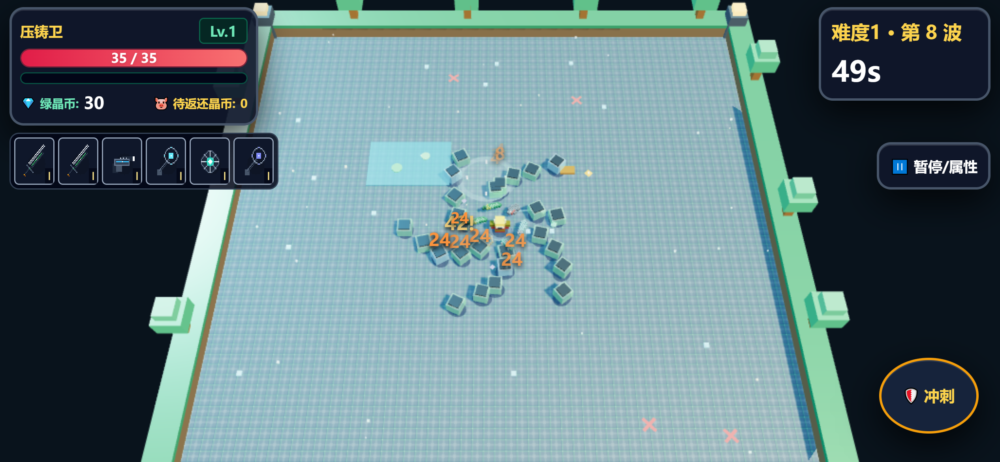

# 余烬回路 · Ember Circuit

运行于浏览器的三维体素幸存者游戏：移动走位、自动攻击、收集资源，在每波之间购买、合成武器并选择核心构筑。使用 Three.js，游戏代码集中在单个 HTML 文件中。

当前版本：**1.15.1**。包含 **42 款武器、50 件饰品、12 种核心和 6 位 Boss**，最多同时装备 6 把武器。手机推荐横屏游玩。



*手机横屏浏览器模拟截图，视口 844 × 390；用于展示布局，非实体手机性能测试。*

## 启动

使用支持 WebGL 的现代 Chrome 或 Edge，保持联网以加载 Three.js 与 Tailwind CDN。启动本地服务需要 **Node.js 20 或以上版本**。

```powershell
git clone https://github.com/ghkkdb/Ember.git
cd Ember
node tools/test-server.cjs --open
```

- 游戏入口：[http://127.0.0.1:8765/](http://127.0.0.1:8765/)
- 机制测试台：[http://127.0.0.1:8765/test](http://127.0.0.1:8765/test)
- Windows 也可双击 [启动测试工具.cmd](tools/启动测试工具.cmd)。若默认端口被占用，以终端输出地址为准。

启动游戏无需安装 npm 依赖。也可直接用浏览器打开 [terrabrotato.html](terrabrotato.html)，仍需联网加载 CDN。测试台只在本机回环地址开放；详见 [测试台说明](tools/README.md)。

## 操作

| 操作 | 桌面端 | 手机端 |
| --- | --- | --- |
| 移动 | WASD / 方向键 | 左侧触屏拖动摇杆 |
| 攻击 | 自动攻击 | 自动攻击 |
| 冲刺 | 空格 | 右下角冲刺按钮 |
| 暂停与设置 | Esc / 暂停按钮 | 暂停按钮 |
| 切换视角 | V / 设置面板 | 设置面板 |
| 调整镜头高度 | 设置或暂停面板 | 设置或暂停面板 |
| 切换场景 | B / 设置面板 | 设置面板 |
| 武器详情 | 点击顶部武器槽 | 点按顶部武器槽 |

默认使用微倾 2.5D 视角，镜头高度 40。可选择 **32 / 40 / 48 / 56** 四档高度；视角与高度会保存。横屏手机采用紧凑 HUD，商店支持滚动，触屏按钮留有足够点击区域。

## 当前玩法与优化

- **武器成长**：同名同阶武器可二合一升阶，受当前波次品质解锁限制。合成预览显示成长；不同武器拥有穿透、领域、爆炸、连锁等机制。
- **饰品适配**：购买前显示当前适配武器、暂无适配或通用辅助，便于判断构筑方向。适配提示表示机制关联，不等同于最终伤害一定提升。
- **商店锁定**：未锁定时显示“锁定”和“刷新时替换”；锁定后卡片出现金色外框、状态条及“取消锁定”按钮。有效且未购买的锁定商品会保留到刷新和下次商店；取消后重新参与替换。购买后不再保留。
- **回合结算**：回合结束自动拾取全部掉落物；奖励处理后，在对应武器槽下显示“本轮伤害：数值”。同名武器按装备实例分别统计，读档可恢复。
- **击杀反馈**：限量保留倒地、爆裂环和击杀音效；粒子、特效与模型释放有预算，减少密集击杀时的卡顿和晃眼。
- **Boss 成长**：第 5 波保留基础参数，第 10 波起逐步增强血量、伤害和进攻节奏；后续循环持续成长，并保留可躲避的预警。难度档位额外影响血量。
- **存档**：支持保存进度回到标题、继续游戏，以及本地设置保存。清除浏览器站点数据会清除本地存档。

## 开发与验证

```powershell
npm ci

# 全部规则与流程回归（当前 203 项）
node tests/run.cjs

# 当前版本真实 Chrome 页面验收及截图；需要本机安装 Chrome
node analysis/browser-smoke-v1.15.1.cjs

# 根据当前代码重新生成武器、饰品与敌人图鉴
node analysis/weapon-catalogue.cjs
node analysis/content-catalogue.cjs
```

本轮验证包含武器与饰品锁定/解锁、刷新保留、存档恢复、横竖屏布局、触屏移动和冲刺，以及战斗与回合伤害流程。浏览器结果与截图位于 [artifacts/v1151](artifacts/v1151/)。固定构筑模拟及软件 WebGL 验收不代表真人胜率、实体手机帧率或全部难度已经平衡。

| 路径 | 内容 |
| --- | --- |
| [terrabrotato.html](terrabrotato.html) | 游戏逻辑、数值、渲染与界面 |
| [tools](tools/) | 本地服务器与图形化测试台 |
| [tests](tests/) | 自动回归测试 |
| [analysis](analysis/README.md) | 数值核算、图鉴导出与浏览器验收脚本 |
| [docs](docs/README.md) | 当前规则、数值图鉴及历史实施记录 |
| [assets](assets/) | 像素素材与资源 |

详细数值见 [武器攻击与核心适配](docs/武器攻击与核心适配.md)、[道具与敌人图鉴](docs/道具与敌人图鉴.md)。本次更改见 [1.15.1 实施记录](docs/v1151-实施记录.md)。历史文档仅对应当时版本，当前实现以代码和带源码指纹的最新图鉴为准。

## 许可

仓库目前未附独立的 LICENSE 文件；使用或再分发前请与作者确认授权。
