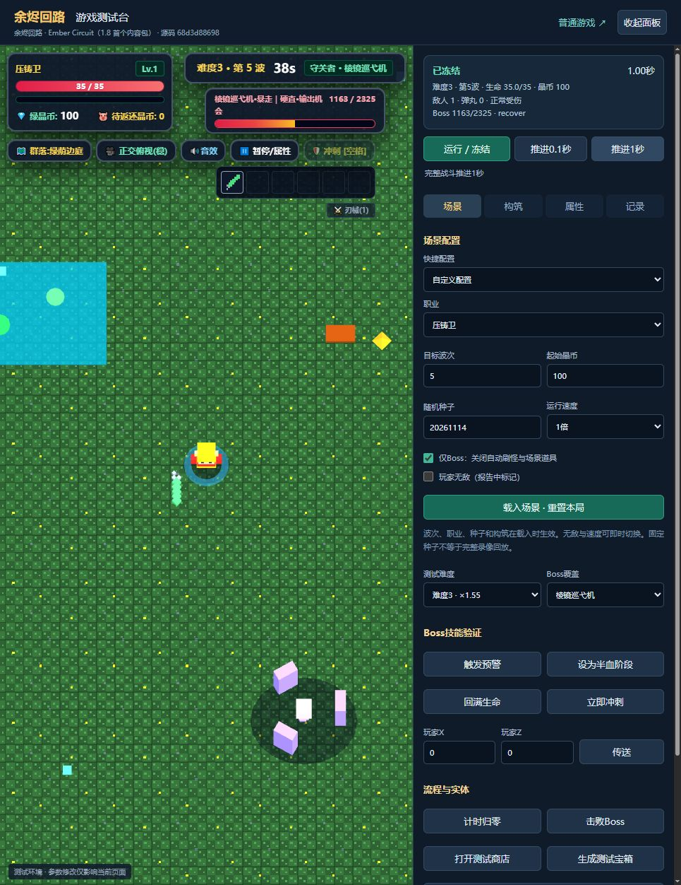
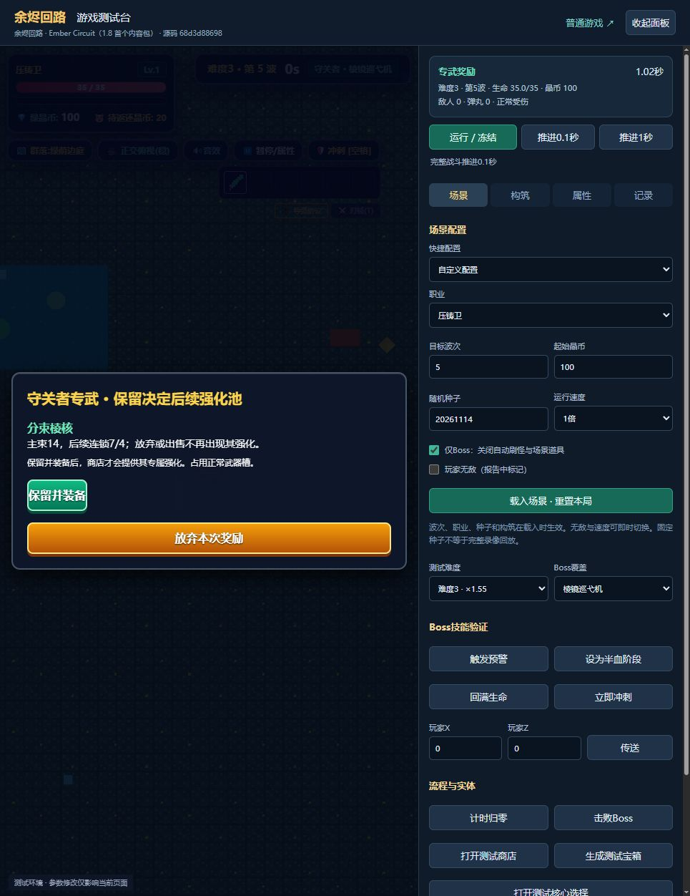

> 历史记录：以下数量、规则与测试结论对应当时版本。当前1.11请查[交付文档](../交付文档.md)，链接的实时图鉴已更新到当前版本。历史数据在analysis/history；当前脚本读取现行产品，不复现旧版。

# 1.8《余烬回路》首个内容包实施记录

日期：2026-11-14。本文件现为1.8历史记录，当前1.9武器表现与核心适配以 [武器说明](../武器攻击与核心适配.md) 为准。1.8基于1.7实施，保持现有3D体素、像素纹理、环绕武器和俯视画风。项目目录和入口文件名保留，游戏工作名改为《余烬回路》。本次交付规则与首包纵向流程，完整目录和长期平衡继续分阶段完成。

对应源码SHA-256：`68d3d886981281fddc142d54abf92e5dfda75e6e7a1f53feb16b33de43400771`。本轮三份数值JSON均记录相同源码指纹；后续改代码后需重新生成，不能沿用旧结果。

## 已接入的规则

| 规则 | 当前实现 |
| --- | --- |
| 基础属性 | 原14项加范围%、暴击效果%，共16项；暴击效果初始0 |
| 攻击范围 | 旧武器基础距离和覆盖按70%缩减；范围每点增加1%攻击可达距离和拾取距离，拾取基础3.0，不再由幸运提供 |
| 近战上限 | 缩减后基础距离的1.75倍与6.0世界单位取较小值；从玩家中心判定；混合武器的刃波单独按远程计算 |
| 远程距离 | 不设数值硬上限，弹道按实际距离预算飞行，寿命随射程延长；范围不同时放大爆炸、领域半径或连锁跳距 |
| 升级 | 自动仅增加1点生命上限，沿用同时回复1点生命；结算仍保留一次四选一属性，不自动增加伤害、攻速等属性 |
| 闪避 | 有效上限默认60%；角色/装备独立`dodgeCapBonusPct`扩展，修正本身不提供闪避，移除后重算 |
| 全伤害 | 有效正向上限50%，保留未截断的基础累计值；面板和实际伤害使用同一有效值，纯封顶升级候选移除 |
| 暴击效果 | 倍率为`max(1,1.75+有效暴击效果/100)`；商店按每把武器展示实际倍率 |
| 盈锋转换器 | 超过100%的原始总暴击率按2∶1转为该武器暴击效果；保留100%实际暴击率，卸装可逆，不写回全局重复转换 |
| 难度 | 1～5档，敌方生命×1/1.25/1.55/1.90/2.30；完成20波解锁下一档，仅保存解锁记录 |
| 波次 | 每5波Boss，第10波继续，第20波胜利；可继续无尽并处理尚未领取的本波奖励 |
| 品质 | II/III/IV阶按第3/8/14波开放，合成也校验上限；专武使用独立强化 |
| 道具与商店 | 执行持有上限；保留两格普通武器保障，适配核心优先；同店普通武器不重复ID，锁定商品预先预留 |

1.7的储蓄等额返还、返还部分不重复经验、普通怪货币预算、收获只发钱及商店价格系数继续沿用。

## 实际可获得内容

| 内容 | 首包实际 | 完整方案目标 | 当前边界 |
| --- | ---: | ---: | --- |
| 普通武器 | 17 | 30 | 原13款改为原创名称、图标与部分行为过渡，新增4款；不等于17款都完成目录最终重制 |
| Boss专武 | 3 | 6 | 可领取、替换、放弃，独立实例与0～3级强化 |
| 道具 | 20 | 49 | 原17款改名并执行上限，新增转换器、回收磁环、增幅镜片；旧道具多数沿用原效果 |
| 核心 | 6 | 12 | 重锤、分流、滞爆、导弧、机巢、蓄压 |
| Boss | 3 | 6 | 每位3种技能，半血变化、预警、硬直，洗牌袋随机出场 |

新增普通武器：

- **导电棱镜**：主目标后连锁两个不同敌人，跳伤衰减、去重，后续跳伤不暴击；导弧增加一跳并付出主伤代价。
- **凝霜雾灯**：固定落点四跳冷雾，每跳最多3个目标，不暴击；普通怪减速20%，Boss最多15%。
- **磁轨哨机**：部署固定哨位4秒，部署周期6秒；攻速只提高射击频率。机巢拆成两个较弱哨位，构装全局上限6个。
- **蓄压轨枪**：蓄力后沿锁定方向释放贯穿弹，最多3目标并衰减；蓄压增强主击，同时增加等待与蓄力移动代价。

已接入两个指定独有效果：折锋短刃连续命中同目标三次，第三刺增伤25%；铆钉速射器累计六次主弹命中后，第七发降低伤害并穿透2个目标。其余F效果尚未上线。

## Boss、核心与专武闭环

| Boss | 三种技能初版 | 对应专武与路线 |
| --- | --- | --- |
| 裂砧执刑者 | 锁线重击、环形震荡、三向扇区 | 断响铰锤：蓄力主击及延迟震波，可搭重锤/滞爆/蓄压 |
| 鸣砂织母 | 网线、限量召唤、三处锁点 | 簇砂蜂巢：固定砂蜂哨位，当前直接适配机巢；跟随双针蜂及第二条独立核心路线待补 |
| 棱镜巡弋机 | 折线打击、缺口慢弹、换位脉冲 | 分束棱核：主束和去重连锁，可搭导弧/分流；分流只复制主束 |

难度1第5/10/15/20波Boss生命锚点为1500/6000/10500/15000，与出场种类无关；无尽每5波在15000基础上继续乘1.22。召唤小怪不产晶币或宝箱，数量与存续时间受限。旧Boss名称ID仅在回归兼容入口保留，不进入正常随机池。

核心随机提供3个不同选项，至少一个适配当前已持有武器；候选保存到选择结束，重复打开不重抽。一局只能保留一种核心，放弃后可在下个Boss结算再次选择。当前先处理已有普通宝箱、升级，再选核心、处理专武，最后进入商店。

Boss不再掉宝箱，死亡后记录专武奖励。保留必须装备，占普通6槽；满槽由玩家明确选择替换，旧武器出售回款只发一次。放弃不进入强化池；出售后资格撤销，已锁定的对应强化卡立即失效。重复同款专武不生成第二实例，可重配分支并保留等级。

专武强化最多3级，首次选择聚焦或广域，后续沿用。首包共用参数：聚焦每级伤害+8%；广域每级伤害+3%、相应覆盖+12%（震波面积、连锁跳距或哨位射程）。不等于完整目录的每武器专属分支均已实现。强化最多占商店一格，25%出现率；连续3次新进商店无强化后，下次新进店保底，刷新不推进计数。强化基价32/48/68，另乘商店及波次系数。

## 验证与实测

106项Node回归通过：旧回归49、构筑10、测试工具12、前期经济8、新规则27。直接执行：

```powershell
node tests/regression.test.cjs
node tests/builds.test.cjs
node tests/test-tool.test.cjs
node tests/early-game.test.cjs
node tests/v18.test.cjs
```

新测试覆盖实际暴击转化伤害与卸装、闪避扩展、近远距离、弹道预算、升级选择、难度倍率只乘一次、洗牌袋、每5波Boss、9种技能可执行、核心候选、满槽替换返款、专武唯一/分支/满级/出售撤销/保底、衍生去重、构装上限及清理、20波真实结算解锁和继续领奖。

浏览器已核对难度3第5波棱镜生命2325、半血、预警后硬直提示、随机核心→专武奖励→商店、16属性及每武器暴击倍率，未捕获控制台错误。Windows启动器`--check`通过，仍保持CRLF。专武强化购买与出售撤销由真实产品方法回归验证；本轮浏览器检查未覆盖全部分支组合。





截图使用测试台强制击杀与步进，只证明界面/流程，不作为正常通关或Boss耗时证据。

前五波脚本保留真实购买、拾取、升级、掉落和储蓄，不注入金钱、不无敌；以60Hz脚本走位，固定种子11/29/47，不选核心。每帧拒绝非有限坐标或生命，渲染对象为替身。

| 策略 | 到达第5波商店 | 第5波购买后余钱（种子11/29/47） | Boss击杀秒数 |
| --- | --- | --- | --- |
| 输出优先 | 3/3 | 37 / 0 / 50 | 26.6 / 30.4 / 36.1 |
| 频繁刷新 | 3/3 | 0 / 7 / 5 | 49.4 / 66.2 / 45.3 |
| 经济优先 | 3/3 | 27 / 29 / 61 | 37.5 / 42.8 / 19.3 |
| 存钱不消费 | 0/3 | 第4/3/2波失败 | 未进入Boss结算 |

旧截图手工六武器压力构筑的第5波Boss耗时约17.0～19.9秒；这是强制构筑，不能代表正常前期获取。部分正常脚本Boss耗时超过方案15～25秒目标，尤其频繁刷新策略；不能把本轮结果解释为平衡已达标。

输出策略延长到20波，三个种子分别在第11/6/9波失败；脚本放弃核心、满槽后不主动优化普通武器替换，尚不能证明完整20波经济与难度通过。只证明规则回归通过和这些固定策略的结果，不是玩家胜率。后续优先做主动换装、各核心同预算构筑与恢复能力验收。

可复算数据：`analysis/history/early-game-v1.8.json`、`analysis/history/progression-v1.8.json`、`analysis/history/balance-audit.json`。前两者为脚本实战，最后一份为理想命中模型，不是实战DPS。

```powershell
node analysis/early-game-benchmark.cjs
node analysis/progression-benchmark.cjs
node analysis/balance-audit.cjs
```

## 后续阶段

1. 完成现有3专武的独立分支与视觉；扩展剩余武器、道具、核心和Boss，逐款实现后再进入随机池。
2. 继续清理旧职业/场景装饰和部分普通敌人的素材辨识，保持现有画风；本轮不宣称全部素材原创化完毕。
3. 补齐各核心至少两套同预算构筑，先校验前5波较慢Boss与第6～11波生存断点，再进行真人20波验收。
4. 实施IV阶校准、后期交换道具、完整伤害来源拆分和30/50波性能/经济模拟。当前无尽仍会重复池内内容，没有用虚构条目或无限品质填充。

1.7产品源码保留在`analysis/fixtures/terrabrotato-v1.7.html`，旧数值JSON与对照文档保留作历史资料。当前测试服务器读取实际HTML，重启或刷新后生效；旧版已打开页面需要刷新并重新开局。
