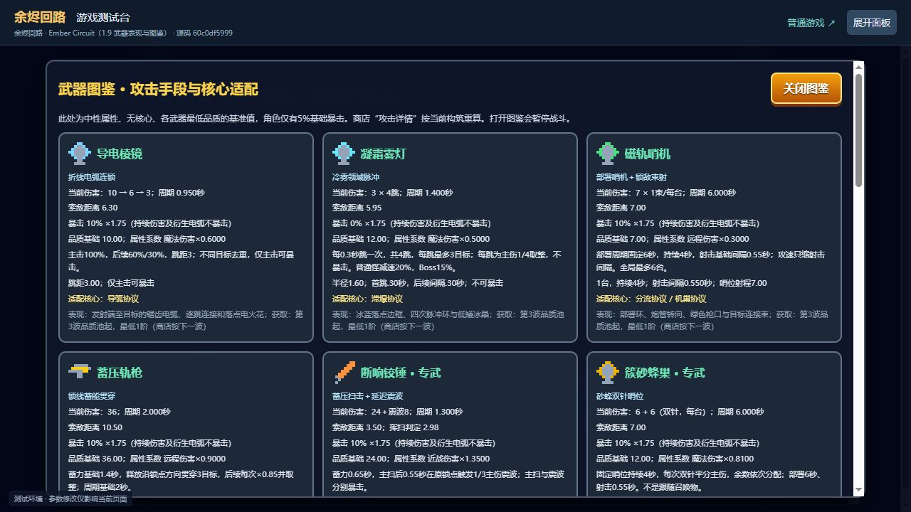

> 历史记录：以下数量、规则与测试结论对应当时版本。当前1.11请查[交付文档](../交付文档.md)，链接的实时图鉴已更新到当前版本。历史数据在analysis/history；当前脚本读取现行产品，不复现旧版。

# 1.9 武器表现与图鉴实施记录

本轮围绕“攻击来源不清楚、缺少特效、武器数值和核心适配难以查看”实施。保持现有3D体素画风与20款武器规模，没有用特效额外增加攻击范围、免费伤害或新武器数量。

完整数值见 [武器攻击与核心适配](../武器攻击与核心适配.md)，包含20款武器各品质伤害、分段预算、周期、距离、暴击、品质属性系数、获取波次和各核心变体。文档由实际产品方法生成，源码指纹与验证记录见`analysis/history/verification-v1.9.json`。

## 战斗表现

- 近战：突刺增加白色刺芯，挥扫增加白色刃缘和残弧，第三刺强化增加金色命中环。
- 直射：弩箭、铆钉、重栓和针弹使用长条模型及白色尖端；枪口闪光、飞行拖尾和命中闪区分发射与落点。
- 回旋/穿透：飞轮、切片与切割器增加旋转齿片；波盘有同心波纹和边界反弹闪圈；刃波增加白色束芯。
- 连锁：从武器发射端连接到主目标，再按实际跳伤顺序连接不同目标，结束后自动淡出。
- 领域：冷雾落点增加冰晶和四次脉冲环；引针增加锁点十字、预热圈、升起光柱与命中扩散。
- 构装：哨机和砂蜂增加发射槽、部署环、瞄准转向、枪口及射击束。砂蜂为实际双针，不是只画两条线却仍算原来的独立双份主伤。
- 蓄力：轨枪与铰锤增加持续锁线和四段能量格，锁点方向随玩家与原锁点的相对位置更新；释放前不造成伤害。释放、清场、改构筑时回收挂载模型。

新增瞬时特效最多96个，不调用战斗随机数，不参与碰撞或触发。友方地面反馈低透明显示。新特效、友方弹道和原有斩击过期时释放自己的几何及材质；不释放素材工厂共享的粒子资源。图鉴和暂停期间停止战斗与攻击特效计时。

## 攻击与核心联动

1. 导弧新增适配双相飞轮、涡轮切片、回旋切割器：主伤-15%，每次释放的首次有效敌人命中额外分出一道30%伤害电弧，跳距3；不暴击、不吸血、不递归，去返重复命中不再次分弧。
2. 分流新增适配三棱针筒、磁轨哨机、簇砂蜂巢：针筒为两组三针；哨位每次射击为两组束/针。每组60%主伤，射击间隔增加15%；哨位部署仍为6秒，不能同时享受部署和射速缩短。
3. 砂蜂每次双针分摊同一份主伤；针筒三针也改为整数预算分配。低伤害时允许个别针分到0并不生成伤害弹，避免每枚强制至少1造成预算膨胀。最低品质无属性针筒现在为4+4+3，而不是三个独立取整的4。
4. 重锤击退两个轴统一为+50%，消除原有纵向+60%的差异。

基础武器主伤配置、普通品质倍率、难度倍率和经济规则保持本轮开始时的值；上述核心扩展与分针整数修正是真实玩法变化，不应当视为纯视觉修改。完整20波、各核心同预算强度仍需持续调校。

## 游戏内说明

主菜单与战斗HUD新增“武器图鉴”。打开后保存原状态并暂停，关闭恢复原状态；从菜单关闭不会误进入战斗。图鉴采用中性属性、角色基础暴击5%、无核心、无羁绊、无道具、最低品质。

商店货架和持有武器新增可展开的“攻击详情”，读取当前角色属性、品质、核心、转换器与专武强化等级。区分索敌距离、实际挥扫距离与刃波距离，并显示当前分段伤害、周期、暴击倍率、属性系数和直接适配核心。波次显示同时校验武器开放和最低品质开放，不再把IV阶武器写成第1波可得。

测试台报告新增每武器详情、核心资格和攻击效果数量；顶部显示瞬时特效数量与96个上限，便于密集攻击检查。

## 验证

116项Node回归通过：49旧回归、10构筑、12工具、8前期经济、27个1.8规则、10个1.9武器与特效测试。新测试验证全部20款的数据完整性、图鉴与当前构筑分离、分弹守恒、实际双针/六针命中、导弧次数与触发限制、特效随机数隔离/容量/回收、蓄力挂载、弹道模型和图鉴暂停恢复。

浏览器中已验证图鉴20款条目、品质开放与四位小数系数，以及电弧、冷雾、哨位、轨枪和铰锤的六武器同屏场景；0.30秒步进时显示11个瞬时特效、5个持续攻击，伤害和Boss生命实际变化。该场景手工装备专武和未到开放波次的武器，只用于表现验收，不代表正常获取或平衡。



浏览器多次初始化记录到同一类`MutationObserver.observe`参数错误，日志未给出来源文件，项目代码中没有该API；来源尚未定位。图鉴与场景操作正常，不能据此宣称浏览器控制台完全无错误。本轮也没有做30/50波长期帧耗时验收。

复算命令：

```powershell
node analysis/weapon-catalogue.cjs
node tests/v19.test.cjs
```

原1.8源码保留在`analysis/fixtures/terrabrotato-v1.8.html`，旧数值报告留作历史资料；刷新页面并重新开局使用本版。
